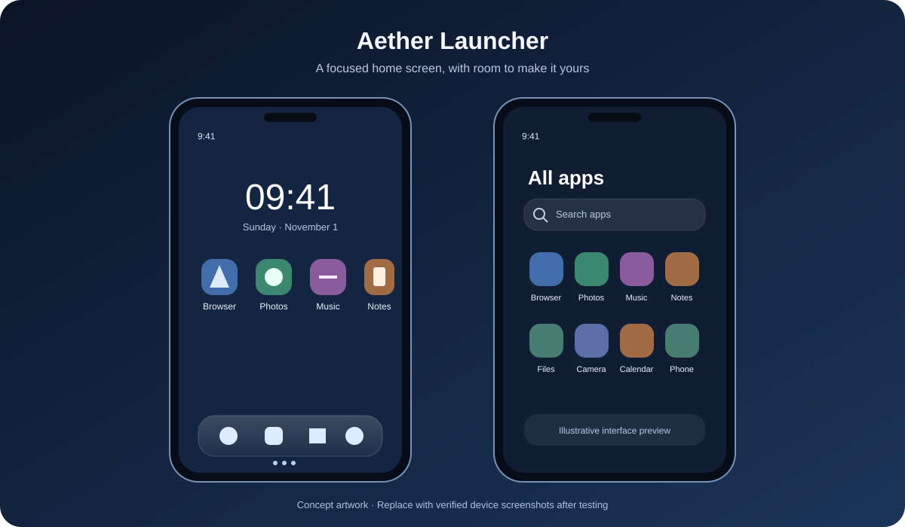

<div align="center">


# Aether Launcher

**A calmer, faster home for Android.**

A lightweight native Android launcher with a clean home screen, searchable app drawer, floating dock and flexible pages.


</div>

## Visual preview

<p align="center">
  
</p>

> **Artwork note:** This is an illustrative interface preview, not a screenshot captured from a running device. Actual device screenshots should replace or supplement it after the current build is installed and verified.

## About

Aether Launcher is an independent Android home-screen replacement. Its visual direction combines a restrained, minimal layout with soft glass-inspired surfaces and clear app organization. It is not Huawei software and does not replace Android system UI.

## Features

- **Home screen:** live date and clock, app grid, floating dock and saved layout.
- **Multiple pages:** add home pages with the **+** control and move between them using page indicators.
- **Pin apps:** long-press an app in the drawer to pin it to the selected home page. A new page is created when the current page is full.
- **App drawer:** discover installed launchable apps, search and browse categories.
- **Gesture navigation:** swipe up from the dedicated area below the dock to open the app drawer.
- **Folders and widgets:** organize shortcuts and host supported Android widgets.
- **Appearance:** preferences for dark appearance, translucency and grid columns.
- **App refresh:** package changes trigger an app-list refresh; activity icons are cached to reduce repeated loading.
- **System integration:** Android's default Home flow and shortcuts to supported system settings.

## Getting started

### Requirements

- Android 8.0 (API 26) or later
- JDK 21
- Android SDK / Android Studio
- Gradle wrapper included in this repository

### Build from source

```bash
git clone https://github.com/faizannazir/Aether-Launcher.git
cd Aether-Launcher

./gradlew test
./gradlew assembleDebug
```

The debug APK is generated at:

```
app/build/outputs/apk/debug/app-debug.apk
```

To build a release APK:

```bash
./gradlew assembleRelease
```

Release signing must use the established keystore. See [Install and update](#install-and-update).

## Set Aether as the default launcher

1. Install and open Aether Launcher.
2. Open **Settings** inside Aether.
3. Select **Set as default launcher**.
4. Confirm Aether in Android's system dialog.

Android requires the user to choose the default Home app; a third-party launcher cannot silently take over this role.

## Home screen gestures and actions

| Action | Result |
| --- | --- |
| Tap an app icon | Launch the app |
| Long-press an app in the app drawer | Pin it to the current home page |
| Tap a page indicator | Switch to that home page |
| Tap **+** beside the indicators | Add a new home page |
| Swipe up from the strip below the dock | Open the app drawer |
| Long-press an empty home area | Open home edit mode |

## Install and update

The Android application ID is `com.aether.launcher`. The development version on this branch is **1.2.0** (version code **3**).

Android permits an in-place update only when all of these conditions are met:

1. The new APK uses the **same signing certificate** as the installed APK.
2. Its version code is higher than the installed version.
3. The APK is compatible with the device's Android version and architecture.

The release workflow expects these GitHub Actions secrets:

- `KEYSTORE_BASE64`
- `KEYSTORE_PASSWORD`
- `KEY_ALIAS`
- `KEY_PASSWORD`

**Keep the original release keystore safe. Do not create a new signing key to publish an update.** If the original key is unavailable, Android rejects an APK signed with a different certificate. Uninstalling the old app first may allow installation, but removes its local app data.

Debug builds use a debug signing key and cannot update a release-signed installation (or vice versa).

## Project boundaries

A launcher can provide the Home screen, app drawer, its own settings, widgets and in-app navigation. Android and the device manufacturer retain control of privileged interfaces such as global Settings, Quick Settings, the lock screen, notification shade, recents and system gesture navigation. Aether can open supported system settings screens; it cannot replace those operating-system interfaces.

Aether uses launcher-activity package visibility rather than requesting broad `QUERY_ALL_PACKAGES` access. It does not rely on root access, hidden installation, accessibility-based device control or device-admin takeover.

## Screenshots

The overview artwork above is a design illustration, not a device capture. Real screenshots should be captured from a verified build and added under `docs/screenshots/`. Suggested captures:

- `home-screen.png` — primary home screen and dock
- `app-drawer.png` — app list and search
- `home-pages.png` — page indicators and add-page control
- `settings.png` — launcher appearance and grid settings

When adding screenshots, use a consistent device resolution, hide personal notifications and accounts, and capture the actual running app rather than mockups.

## Contributing

Bug reports and focused improvements are welcome. Please include:

- Android version and device model
- Steps to reproduce the issue
- Expected and actual behaviour
- Relevant logs or screenshots (remove personal information)

For gesture, rendering and installation changes, test on a physical device as well as running the unit tests.

## License

See [LICENSE](LICENSE) for the project license.
